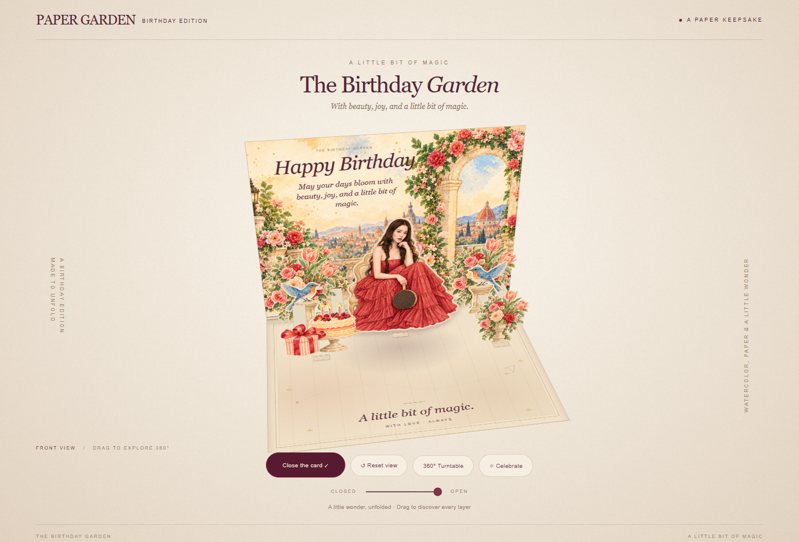

# 🎂 Birthday Pop-up Card Skill

把三张参考图，变成一张可以在浏览器里打开、折叠、旋转和欣赏的 3D 立体生日贺卡！💌✨

这个 Skill 对小白很友好。你只需要准备图片并回答几个简单问题；助手会先制作人物预览，等你确认人物满意后，再继续完成整张卡片。

## 🌟 它可以做什么？

- 📖 模拟真实纸质贺卡的打开、合拢和折叠
- 🎭 制作前、中、后景分明的多层纸艺结构
- 👤 根据真人照片制作高相似度 Q 版人物贴纸
- 🎈 搭配气球、彩带、鲜花、礼物、蛋糕等主题元素
- 🖱️ 支持拖动、360° 旋转、缩放和视角重置
- 🎊 打开时播放彩纸或庆祝动画
- 💻 最终交付可离线打开的单个 HTML 网页

## 🖼️ 使用前要准备什么？

准备三张图片即可。它们各自有不同的任务：

| 图片 | 负责什么 | 可以选择什么图？ |
| --- | --- | --- |
| 🧩 图 1：结构参考 | 决定卡片怎么打开、人物站在哪里、分成多少层 | 喜欢的实体 Pop-up Card 照片 |
| 🎨 图 2：风格参考 | 决定笔触、配色、纸张质感和插画气质 | 水彩、复古、童话、拼贴或手绘作品 |
| 📸 图 3：人物参考 | 决定主角的长相、发型、服装、颜色和手持物 | 清晰的单人照、合照或全身照 |

> 💡 不确定图片用途也没关系，直接发给助手。素材不足时，助手会继续向你提问，不会在信息不完整时直接开工。

## 🚀 一句话开始使用

把三张图发给助手，然后说：

> 使用 `$birthday-pop-up-card` 帮我制作生日立体贺卡。请先和我确认需求，只生成人物预览；等我确认人物后，再继续生成完整网页。

还可以补充你的个性化想法，例如：

> 整体使用酒红色和奶油色，主题是“鬼马少女的旅行”。人物手里牵着红色气球，加入旅行箱、小鸟、鲜花、彩带和闪光。所有页面文字使用英文。

## 🪄 实际制作流程

### 1. 先聊清楚你想要什么 💬

助手会查看三张图，并确认寿星、人物数量、祝福语、页面语言、配色、装饰元素和交互效果。你不用填表，也不用编辑 JSON，像聊天一样回答就可以。

### 2. 先做人物，不急着做网页 👧🏻

需求确定后，助手只会先制作人物贴纸预览。默认是约 3 头身、头稍大，同时保留真人五官、发型、服装和配饰特征。

人物预览通常会包含：

- 🤍 白色贴纸轮廓和柔和阴影
- 👗 与原照片一致的服装结构和颜色
- 🎈 完整的手持物，例如气球、线、打结处和牵气球的手
- 🙂 清楚可辨的五官，不让装饰遮住脸部

如果还不满意，可以继续提出：“眼睛保持原样”“衣服颜色以照片为准”“气球要完整出现”等修改意见。

### 3. 你确认人物后，才开始制作卡片 ✅

人物满意时，请明确回复：

> 这版人物确认，可以继续生成完整网页。

这是重要的确认门槛。只确认整体方案，不代表人物已经确认；没有看到并批准人物图，Skill 不会提前生成网页。

### 4. 生成多层立体卡片 🎁

人物确认后，助手会制作背景、装饰和纸艺结构。卡片会尽量画面充盈，但不会遮住人物脸部、关键服装或祝福文字。

常见层次包括：

1. 🌆 后景：祝福语、天空、拱门、远景或主题图案
2. 🎈 中景：气球、彩带、鲜花、小鸟、礼物和旅行箱
3. 👤 前景：主角人物、蛋糕和重点装饰
4. 🌸 底座：花瓣、丝带、爱心、星光和小纸片

### 5. 检查并交付网页 🌐

最后会检查卡片能否顺利开合、旋转和缩放，人物是否使用了你确认的版本，以及手机和电脑是否都能正常观看。

默认交付：

- 📄 可离线打开的 HTML 成品
- 📁 可继续修改的网页源码
- 📝 简单操作说明

## 🎮 成品怎么玩？

- 点击卡片：打开或合拢
- 鼠标拖动／手机滑动：旋转卡片
- 鼠标滚轮：放大或缩小
- 方向键：调整观看角度
- `Enter` 或空格：打开或关闭
- 重置按钮：回到默认视角
- 彩纸按钮：重播庆祝动画 🎉

## 🎨 默认设计方向

- 约 3 头身的可爱 Q 版人物，同时保留真人辨识度
- 发型、服装、配饰和颜色遵照人物照片
- 人物带白色描边、柔和阴影和轻微悬浮感
- 多层纸片带有厚度、折痕和层间阴影
- 背景、两侧和底座都有主题元素，避免画面过空
- 牵气球等动作会画出完整道具，不只保留举手姿势

这些都可以修改。你可以要求更写实、更加 Q 版、减少装饰、改变配色，或指定不能出现的元素。

## 🙋 常见问题

### 可以放多个人吗？

可以。单人、情侣、朋友或家庭合照都支持。多人形象会逐一确认，避免有人被遗漏或改得不像。

### 照片没有拍到腿和鞋子怎么办？

助手会先询问是保留半身构图，还是根据你的要求补全，不会擅自猜测。

### 可以只提供一张图片吗？

可以先发，但 Skill 会询问缺失的结构、风格或人物素材。只有信息足够明确并得到确认后，才会开始生成。

### 最终是实体卡片刀模吗？

不是。成品是浏览器中的 3D 纸艺视觉模拟网页，不是可直接送厂生产的实体刀模。

### 会直接发布到网上吗？

不会。默认只生成本地文件；只有你明确要求发布时，才会进入发布流程。

## 📂 给开发者看的目录

普通用户不需要操作这些文件：

- `SKILL.md`：核心工作流与两道确认门槛
- `references/`：问答、提示词、纸艺规则和验收清单
- `scripts/`：人物确认、项目创建、验证和打包工具
- `assets/paper-card/index.html`：网页起始模板
- `assets/docs/`：README 示例图片

脚本需要 Node.js 18+，本身不安装第三方依赖。图片生成和浏览器视觉验收仍需要运行环境提供相应工具。

---

准备好三张图，就可以开始做一张只属于你的生日立体贺卡啦！🎂🎈💐
